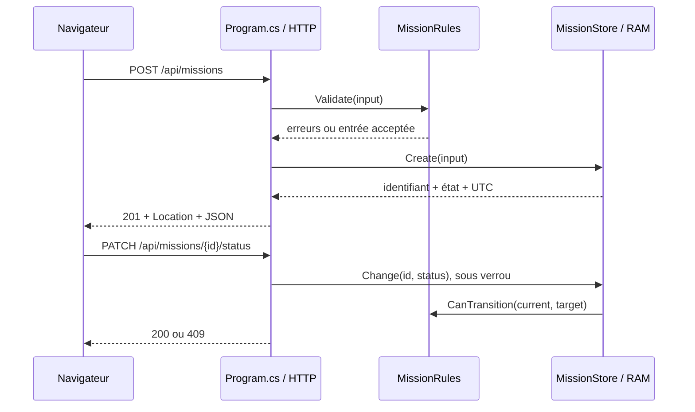

# Architecture implémentée

Le transport lie JSON aux contrats CreateMission/ChangeStatus. Les règles pures ne connaissent pas HTTP. Le store possède les données et verrouille lecture/écriture ; la validation de transition et l’écriture sont atomiques. Les records retournés sont immuables. Les routes n’exposent ni suppression ni modification arbitraire d’état.

Limite : règles et stockage sont dans un même assembly ; séparation logique, pas microservices ni architecture distribuée. Chaque instance possède sa mémoire indépendante. Un équilibrage multi-instance casserait la cohérence. L’API ne déduit aucune identité de l’appelant.
